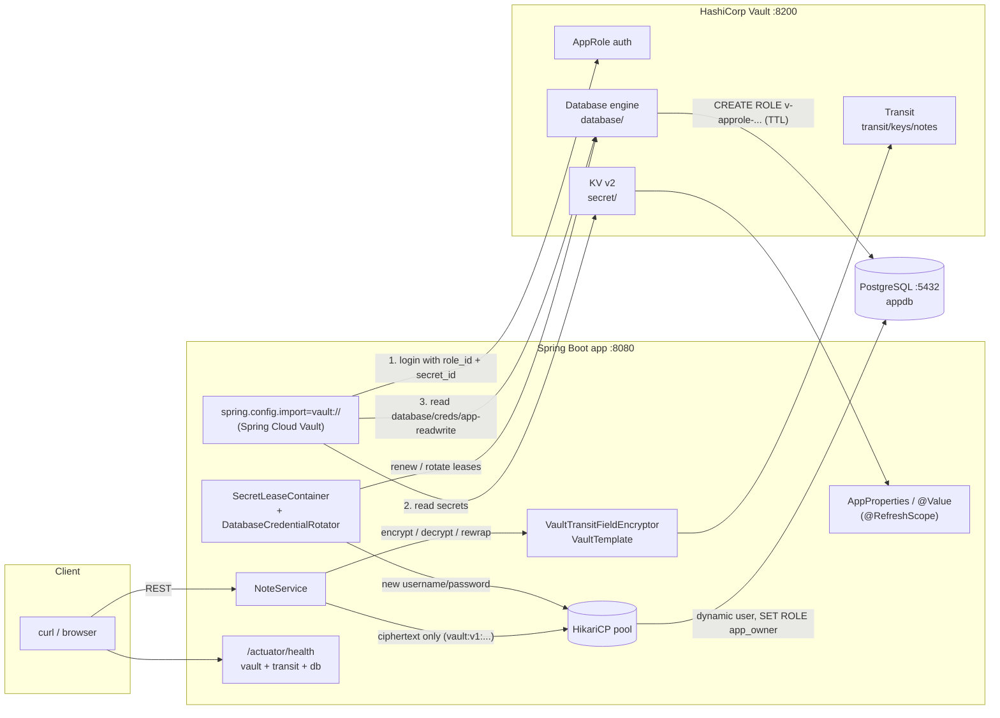

# Vault + Spring Boot sample

[](https://github.com/b88878393/vault-spring-boot-sample/actions/workflows/ci.yml)
[](LICENSE)

A complete, runnable example of how a Spring Boot application uses [HashiCorp Vault](https://developer.hashicorp.com/vault)
through [Spring Cloud Vault](https://spring.io/projects/spring-cloud-vault). It covers what most teams need when they
move secrets out of configuration files:

| # | Feature | Vault component | Where to look |
|---|---------|-----------------|---------------|
| 1 | Static secrets loaded at startup and bound to `@ConfigurationProperties` / `@Value` | KV v2 engine, `spring.config.import=vault://` | [`AppProperties`](src/main/java/io/github/b88878393/vaultsample/secrets/AppProperties.java), [`PartnerApiClient`](src/main/java/io/github/b88878393/vaultsample/secrets/PartnerApiClient.java) |
| 2 | Machine authentication with AppRole, token auth for local development | AppRole auth method, token auth | [`application.yml`](src/main/resources/application.yml), [`application-dev.yml`](src/main/resources/application-dev.yml) |
| 3 | Short-lived PostgreSQL credentials with lease renewal | Database secrets engine | [`application.yml`](src/main/resources/application.yml) (`spring.cloud.vault.database`), [`postgres/init.sql`](postgres/init.sql) |
| 4 | Encryption as a service: notes are stored encrypted in PostgreSQL | Transit engine, `VaultTransitOperations` | [`VaultTransitFieldEncryptor`](src/main/java/io/github/b88878393/vaultsample/transit/VaultTransitFieldEncryptor.java), [`NoteService`](src/main/java/io/github/b88878393/vaultsample/notes/NoteService.java) |
| 5 | Secret refresh and rotation: KV refresh, DB credential rotation at max TTL, Transit key rotation + rewrap | `/actuator/refresh`, `SecretLeaseContainer` | [`DatabaseCredentialRotator`](src/main/java/io/github/b88878393/vaultsample/database/DatabaseCredentialRotator.java), [`ScheduledSecretRefresher`](src/main/java/io/github/b88878393/vaultsample/secrets/ScheduledSecretRefresher.java) |
| 6 | Health checks | `vault` indicator (Spring Cloud Vault) plus a custom `transit` indicator | [`TransitHealthIndicator`](src/main/java/io/github/b88878393/vaultsample/health/TransitHealthIndicator.java) |

Everything runs locally with Docker Compose. The integration test starts real Vault and PostgreSQL containers
through Testcontainers.

> [!WARNING]
> **Every secret in this repository is a demo value**, for example `dev-only-root-token`,
> `vault-admin-demo-password` and `demo-partner-api-key-NOT-A-REAL-SECRET`. They exist only so the sample can run on
> your machine. Never reuse them, and never commit real secrets. See [Security notes](#security-notes).

## Contents

- [Architecture](#architecture)
- [Versions](#versions)
- [Prerequisites](#prerequisites)
- [Quickstart](#quickstart)
- [Features in detail](#features-in-detail)
- [Configuration reference](#configuration-reference)
- [Project layout](#project-layout)
- [Testing](#testing)
- [Security notes](#security-notes)
- [Production hardening](#production-hardening)
- [Troubleshooting](#troubleshooting)
- [Contributing](#contributing)
- [License](#license)

## Architecture



What happens at startup:

1. Spring Boot processes `spring.config.import=vault://`. Spring Cloud Vault logs in with **AppRole**
   (`role_id` + `secret_id` from the environment) and receives a Vault token that carries the
   [`vault-spring-boot-sample`](vault/policies/vault-spring-boot-sample.hcl) policy.
2. It reads the **KV v2** secrets `secret/application`, `secret/vault-spring-boot-sample` and
   `secret/vault-spring-boot-sample/<profile>` and adds them to the `Environment` as property sources.
3. It asks the **database secrets engine** for credentials (`database/creds/app-readwrite`). Vault creates a new
   PostgreSQL user with a TTL, and the username and password become `spring.datasource.username` and `password`.
4. Only then are the beans created. HikariCP, Flyway and JPA use the dynamic credentials. The application code
   never sees a static database password.
5. In the background, the `SecretLeaseContainer` renews the database lease and the Vault token. When the lease hits
   its `max_ttl`, the app rotates to new credentials (see [feature 5](#5-secret-refresh-and-rotation)).

## Versions

Versions were verified against Maven Central, Docker Hub and spring.io in October 2026.

| Component | Version |
|-----------|---------|
| Java | 21 (LTS) |
| Spring Boot | 3.5.16 (latest 3.x) |
| Spring Cloud | 2025.0.3 (release train for Boot 3.5) |
| Spring Cloud Vault / Spring Vault | 4.3.3 / 3.2.1 |
| Maven (wrapper) | 3.9.16 (wrapper 3.3.4) |
| Testcontainers | 1.21.4 (managed by Spring Boot) |
| HashiCorp Vault image | `hashicorp/vault:2.2.0` |
| PostgreSQL image | `postgres:17.11-alpine` |

> [!NOTE]
> Spring Boot 4.x / Spring Cloud 2025.1 is also available. This sample stays on the Boot 3.x line on purpose,
> because that is what most production code bases run today. Moving to Boot 4 mostly means updating the parent and
> the Spring Cloud release train.

## Prerequisites

- **Docker** with the Compose plugin (`docker compose version`)
- **JDK 21**, only if you want to run the app or the tests outside Docker. The Maven wrapper (`./mvnw`) downloads
  Maven for you.
- `curl` for the examples. `jq` is optional and only makes the output prettier.
- Optional: the [`vault` CLI](https://developer.hashicorp.com/vault/install). If it is missing, the init script runs
  the CLI inside the Vault container.

## Quickstart

```bash
git clone https://github.com/b88878393/vault-spring-boot-sample.git
cd vault-spring-boot-sample

# 1. Start Vault (dev mode) and PostgreSQL
docker compose up -d

# 2. Configure Vault: engines, policies, AppRole, demo secrets. Writes role_id/secret_id to .env (gitignored)
./scripts/vault-init.sh

# 3. Build and start the application (it authenticates with AppRole)
docker compose --profile app up -d --build

# 4. Check that everything is healthy
curl -s localhost:8080/actuator/health | jq
```

To run the app from your IDE or with Maven instead of in Docker, skip step 3:

```bash
# AppRole authentication, like in production:
set -a; . ./.env; set +a
./mvnw spring-boot:run

# ...or token authentication with the dev root token (profile "dev"):
SPRING_PROFILES_ACTIVE=dev ./mvnw spring-boot:run
```

### Try it out

```bash
# (1) Configuration loaded from Vault KV v2 (the API key is masked)
curl -s localhost:8080/api/config | jq
# {
#   "greeting": "Hello from Vault KV v2 (demo value)",
#   "maxNoteLength": 2000,
#   "partnerBaseUrl": "https://partner.example.com",
#   "partnerApiKeyMasked": "demo********************************ET",
#   "activeProfiles": []
# }

# (3) The PostgreSQL user the pool is connected as, created by Vault a moment ago
curl -s localhost:8080/api/db/identity | jq
# { "sessionUser": "v-approle-app-read-ZFyj2SlATSoAtt7B9lVF-1792409022", "currentUser": "app_owner", "database": "appdb" }

# (4) Store a note. The content is encrypted by Vault Transit before it reaches the database
curl -s -X POST localhost:8080/api/notes -H 'Content-Type: application/json' \
     -d '{"title":"first note","content":"my demo secret note"}' | jq
curl -s localhost:8080/api/notes/1/stored | jq   # what PostgreSQL stores: "contentCiphertext": "vault:v1:8HGn..."
curl -s localhost:8080/api/notes/1 | jq          # decrypted through Vault

# Raw Transit endpoints
curl -s -X POST localhost:8080/api/transit/encrypt -H 'Content-Type: application/json' -d '{"plaintext":"hello"}' | jq
curl -s -X POST localhost:8080/api/transit/decrypt -H 'Content-Type: application/json' -d '{"ciphertext":"vault:v1:..."}' | jq

# (5) Rotate a KV secret and reload it without restarting
docker compose exec -e VAULT_TOKEN=dev-only-root-token vault \
  vault kv patch secret/vault-spring-boot-sample app.greeting="Hello after rotation (demo value)"
curl -s -X POST localhost:8080/actuator/refresh        # ["app.greeting"]
curl -s localhost:8080/api/config | jq .greeting      # "Hello after rotation (demo value)"

# (5) Rotate the Transit key, then re-encrypt all notes with the new key version
docker compose exec -e VAULT_TOKEN=dev-only-root-token vault vault write -f transit/keys/notes/rotate
curl -s -X POST localhost:8080/api/notes/rewrap        # {"rewrapped":1}
curl -s localhost:8080/api/notes | jq '.[].keyVersion' # 2

# (6) Health, including Vault and the Transit round trip
curl -s localhost:8080/actuator/health | jq '.components | {vault, transit, db}'
```

If you have the `vault` CLI installed, you can use `export VAULT_ADDR=http://127.0.0.1:8200 VAULT_TOKEN=dev-only-root-token`
and run the `vault ...` commands directly instead of going through `docker compose exec`.

### Stop and clean up

```bash
docker compose --profile app down        # stop everything (the dev Vault forgets all its data)
docker compose --profile app down -v     # also delete the PostgreSQL volume
```

The dev-mode Vault keeps its data in memory. **After a restart of the `vault` container, run `./scripts/vault-init.sh`
again**, then restart the app: `docker compose --profile app up -d --force-recreate app`.

## Features in detail

### 1. Static secrets from KV v2

[`application.yml`](src/main/resources/application.yml) imports Vault as a Spring Boot
[config data](https://docs.spring.io/spring-boot/reference/features/external-config.html#features.external-config.files.importing)
source:

```yaml
spring:
  config:
    import: vault://          # mandatory: the app refuses to start without Vault (use optional:vault:// to relax)
  cloud:
    vault:
      kv:
        enabled: true
        backend: secret
        application-name: vault-spring-boot-sample
        default-context: application
```

Spring Cloud Vault then reads these paths. Later entries win:

| Path | Purpose |
|------|---------|
| `secret/application` | Values shared by all applications (optional) |
| `secret/vault-spring-boot-sample` | Values of this application |
| `secret/vault-spring-boot-sample/<profile>` | Profile-specific overrides, for example `.../dev` |

Each key of a secret becomes a property: `app.greeting` in Vault is `app.greeting` in Spring. The app shows both ways
of consuming those values:

- **`@ConfigurationProperties`**: [`AppProperties`](src/main/java/io/github/b88878393/vaultsample/secrets/AppProperties.java)
  binds `app.greeting` and `app.max-note-length`, with validation. This is the recommended style.
- **`@Value`**: [`PartnerApiClient`](src/main/java/io/github/b88878393/vaultsample/secrets/PartnerApiClient.java)
  injects `partner.api-key`. The key is never logged or returned. Only a masked version is exposed.

The import is declared in a profile-activated document (`on-profile: "!dev"`), and the `dev` profile declares its own
import. The reason: Spring Boot processes imports of plain documents *before* it activates profiles, so Vault
settings in `application-dev.yml` would otherwise be ignored.

### 2. AppRole authentication, with token auth for dev

AppRole is Vault's auth method for machines. The app presents a **role ID**, which is not secret on its own and is
comparable to a username, together with a **secret ID**, which is secret and short-lived. In return it gets a Vault
token with the role's policies:

```yaml
spring.cloud.vault:
  authentication: APPROLE
  app-role:
    role-id: ${VAULT_ROLE_ID:}
    secret-id: ${VAULT_SECRET_ID:}
  session.lifecycle.enabled: true    # renew the token, log in again when it cannot be renewed
```

`scripts/vault-init.sh` creates the role with `token_ttl=1h`, `token_max_ttl=4h` and `secret_id_ttl=24h`, and writes
`VAULT_ROLE_ID` and a fresh `VAULT_SECRET_ID` to `.env`. Each run of the script issues a new secret ID. Earlier ones
stay valid until their TTL expires.

The **`dev` profile** ([`application-dev.yml`](src/main/resources/application-dev.yml)) switches to
`authentication: TOKEN` and uses `VAULT_TOKEN`, which defaults to the demo root token of the dev server. This is
convenient for local experiments, but it bypasses the least-privilege policy. Use it only against a throwaway dev
Vault.

### 3. Dynamic PostgreSQL credentials

```yaml
spring.cloud.vault:
  database:
    enabled: true
    role: app-readwrite                         # -> database/creds/app-readwrite
    username-property: spring.datasource.username
    password-property: spring.datasource.password
  config.lifecycle:                             # renew the lease before it expires
    enabled: true
    min-renewal: 10s
    expiry-threshold: 1m
```

The database side is set up in [`postgres/init.sql`](postgres/init.sql) and by the init script:

- `vault_admin` is the PostgreSQL login Vault uses. It has `CREATEROLE` and admin rights on `app_owner`, and nothing
  else.
- The Vault role `app-readwrite` runs
  `CREATE ROLE "{{name}}" WITH LOGIN PASSWORD '{{password}}' VALID UNTIL '{{expiration}}' IN ROLE app_owner;`
  so every generated user is a member of the **`app_owner`** group role.
- The pool runs `SET ROLE app_owner` on every new connection (`spring.datasource.hikari.connection-init-sql`). Tables
  created by Flyway therefore belong to `app_owner` rather than to a short-lived user. That is what makes it safe to
  revoke users (`DROP ROLE`) and to rotate credentials.

`GET /api/db/identity` shows both names: `session_user` is the Vault-generated login, `current_user` is `app_owner`.

### 4. Transit: encryption as a service

The [Transit engine](https://developer.hashicorp.com/vault/docs/secrets/transit) encrypts and decrypts data with a
key that **never leaves Vault**. The app uses the auto-configured `VaultTemplate`:

```java
VaultTransitOperations transit = vaultOperations.opsForTransit("transit");
String ciphertext = transit.encrypt("notes", plaintext);    // "vault:v1:..."
String plaintext  = transit.decrypt("notes", ciphertext);
String rewrapped  = transit.rewrap("notes", ciphertext);    // re-encrypt with the latest key version
```

[`NoteService`](src/main/java/io/github/b88878393/vaultsample/notes/NoteService.java) encrypts the note content before
saving it and decrypts it only when a single note is requested. The `notes.content_ciphertext` column only holds
ciphertext, and a check constraint enforces the `vault:v...` format. Anyone with a database dump, a backup or
read access to the table sees nothing useful. Decrypting requires a Vault token with
`update` on `transit/decrypt/notes`.

The [`FieldEncryptor`](src/main/java/io/github/b88878393/vaultsample/transit/FieldEncryptor.java) interface keeps the
domain code independent of Vault, which makes it easy to test. If you want encryption to be fully transparent, you
can also wrap the encryptor in a JPA `AttributeConverter`.

Endpoints: `POST /api/notes`, `GET /api/notes` (ciphertext only), `GET /api/notes/{id}` (decrypted),
`GET /api/notes/{id}/stored`, `POST /api/notes/rewrap`, `POST /api/transit/encrypt`, `POST /api/transit/decrypt`.

### 5. Secret refresh and rotation

The sample covers three rotation scenarios.

**a) KV secrets: `POST /actuator/refresh`.** KV secrets have no lease, so Vault cannot notify the app when they
change. After you update a value in Vault, call `POST /actuator/refresh`. Spring Cloud reloads the Vault property
sources and then:

- re-binds `@ConfigurationProperties` beans such as `AppProperties` in place. They must be JavaBeans with setters;
  records cannot be re-bound.
- recreates `@RefreshScope` beans such as `PartnerApiClient` on their next use. This is how `@Value` fields pick up
  new values.

To skip the manual call, set `APP_SECRETS_AUTO_REFRESH=true` (and optionally `APP_SECRETS_AUTO_REFRESH_INTERVAL=1m`).
[`ScheduledSecretRefresher`](src/main/java/io/github/b88878393/vaultsample/secrets/ScheduledSecretRefresher.java)
then polls Vault on that interval.

> [!IMPORTANT]
> **Refresh pitfall with dynamic database credentials.** A refresh re-runs the whole `vault://` import, including the
> database backend. Out of the box, every refresh would create *another* PostgreSQL user and lease that nothing uses.
> [`DatabaseImportRefreshGuard`](src/main/java/io/github/b88878393/vaultsample/database/DatabaseImportRefreshGuard.java)
> turns the database import off for refreshes only. It does this through a retained property source
> (`spring.cloud.refresh.additional-property-sources-to-retain`). Database credentials keep their own lifecycle,
> described in b).

**b) Database credentials at `max_ttl`.** Spring Cloud Vault renews the database lease, but it cannot extend it past
the role's `max_ttl`. When the lease expires,
[`DatabaseCredentialRotator`](src/main/java/io/github/b88878393/vaultsample/database/DatabaseCredentialRotator.java)
does three things:

1. It reacts to the `SecretLeaseExpiredEvent` by calling `requestRotatingSecret("database/creds/app-readwrite")`.
2. It receives the new credentials in a `SecretLeaseCreatedEvent` and hands them to HikariCP with
   `HikariConfigMXBean.setUsername/setPassword`.
3. It calls `softEvictConnections()`. Idle connections are replaced right away, and busy ones are replaced when they
   are returned to the pool.

From then on, the container rotates automatically every time the lease expires. To watch this happen, use short
TTLs:

```bash
DB_CREDS_DEFAULT_TTL=40s DB_CREDS_MAX_TTL=90s ./scripts/vault-init.sh
set -a; . ./.env; set +a
./mvnw spring-boot:run -Dspring-boot.run.arguments="--spring.cloud.vault.config.lifecycle.expiry-threshold=15s"
watch -n 5 'curl -s localhost:8080/api/db/identity'
# log: "Database credential lease reached its max TTL; requesting rotating credentials"
#      "Switched connection pool to rotated database user 'v-approle-app-read-...'"
```

**c) Transit key rotation.** An operator rotates the key with `vault write -f transit/keys/notes/rotate`. Rotating
the key is deliberately *not* allowed by the app's policy. Old ciphertexts stay decryptable. `POST /api/notes/rewrap`
re-encrypts every note with the newest key version without the plaintext ever reaching the app. After that, you can
raise the key's `min_decryption_version` to retire old key versions.

### 6. Health indicators

`GET /actuator/health` includes:

- **`vault`**, provided by Spring Cloud Vault. It checks that Vault is initialized, unsealed and active, and reports
  the version.
- **`transit`**, provided by [`TransitHealthIndicator`](src/main/java/io/github/b88878393/vaultsample/health/TransitHealthIndicator.java).
  It runs an encrypt/decrypt round trip of a canary value with the app's own token. Unlike `vault`, this proves that
  authentication and policy work. Disable it with `management.health.transit.enabled=false`.
- **`db`**, which shows that the dynamic credentials are working.

`show-details: always` is a demo setting. Use `when-authorized` in production.

## Configuration reference

Environment variables used by the application:

| Variable | Default | Description |
|----------|---------|-------------|
| `VAULT_ADDR` | `http://localhost:8200` | Vault address (`spring.cloud.vault.uri`) |
| `VAULT_ROLE_ID` | *(empty)* | AppRole role ID, written to `.env` by the init script |
| `VAULT_SECRET_ID` | *(empty)* | AppRole secret ID, written to `.env` by the init script |
| `VAULT_TOKEN` | `dev-only-root-token` | Token for the `dev` profile only (demo root token) |
| `SPRING_PROFILES_ACTIVE` | *(none)* | `dev` switches to token authentication |
| `DB_HOST` / `DB_PORT` / `DB_NAME` | `localhost` / `5432` / `appdb` | PostgreSQL location (credentials come from Vault) |
| `APP_SECRETS_AUTO_REFRESH` | `false` | Periodically reload KV secrets |
| `APP_SECRETS_AUTO_REFRESH_INTERVAL` | `5m` | Interval for the above |

Important Spring properties. See [`application.yml`](src/main/resources/application.yml) for the full set:

| Property | Value in sample | Meaning |
|----------|-----------------|---------|
| `spring.config.import` | `vault://` | Load Vault secrets as configuration |
| `spring.cloud.vault.authentication` | `APPROLE` (`TOKEN` in `dev`) | Auth method |
| `spring.cloud.vault.fail-fast` | `true` | Fail at startup if Vault is unavailable |
| `spring.cloud.vault.kv.backend` / `application-name` | `secret` / `vault-spring-boot-sample` | KV v2 mount and context |
| `spring.cloud.vault.database.role` | `app-readwrite` | Database role for dynamic credentials |
| `spring.cloud.vault.config.lifecycle.*` | `min-renewal: 10s`, `expiry-threshold: 1m` | Lease renewal tuning |
| `spring.cloud.vault.session.lifecycle.*` | enabled | Token renewal |
| `app.transit.backend` / `app.transit.key-name` | `transit` / `notes` | Transit mount and key |
| `management.endpoints.web.exposure.include` | `health,info,refresh` | Exposed actuator endpoints |

Variables of [`scripts/vault-init.sh`](scripts/vault-init.sh). The defaults match `docker-compose.yml`:

| Variable | Default | Description |
|----------|---------|-------------|
| `VAULT_ADDR`, `VAULT_TOKEN` | `http://127.0.0.1:8200`, `dev-only-root-token` | Vault to configure, and an admin token for it |
| `VAULT_CLI_MODE` | `auto` | `local` (CLI on `PATH`), `compose` (CLI inside the `vault` container) or `auto` |
| `PG_HOST`, `PG_PORT`, `PG_DATABASE` | `postgres`, `5432`, `appdb` | PostgreSQL as reachable **from Vault** |
| `PG_VAULT_USER`, `PG_VAULT_PASSWORD` | `vault_admin`, `vault-admin-demo-password` | Login Vault uses to manage users (demo password) |
| `PG_SSLMODE` | `disable` | Use `verify-full` in production |
| `DB_CREDS_DEFAULT_TTL`, `DB_CREDS_MAX_TTL` | `1h`, `24h` | Lifetime of dynamic DB credentials |
| `APPROLE_TOKEN_TTL`, `APPROLE_TOKEN_MAX_TTL`, `APPROLE_SECRET_ID_TTL` | `1h`, `4h`, `24h` | AppRole lifetimes |
| `ENV_FILE` | `./.env` | Where to write `VAULT_ROLE_ID` and `VAULT_SECRET_ID` |
| `FORCE` | `false` | `true` overwrites existing demo secrets and the DB connection config |

The script is idempotent. It enables engines and creates the Transit key only when they are missing, and it does
not overwrite existing demo secrets or the DB connection unless `FORCE=true`. Policies and roles are always
re-applied.

## Project layout

```
.
├── docker-compose.yml               Vault (dev mode) + PostgreSQL + app (profile "app")
├── Dockerfile                       Multi-stage build, layered jar, non-root runtime
├── scripts/vault-init.sh            Idempotent Vault setup (POSIX sh), writes .env
├── vault/policies/
│   ├── vault-spring-boot-sample.hcl Least-privilege policy of the application
│   └── operator.hcl                 Example policy for operators/CI (no root token needed)
├── postgres/init.sql                vault_admin + app_owner roles
├── src/main/java/io/github/b88878393/vaultsample/
│   ├── secrets/                     (1)(5) KV: AppProperties, PartnerApiClient, ConfigController, ScheduledSecretRefresher
│   ├── transit/                     (4) FieldEncryptor, VaultTransitFieldEncryptor, TransitController
│   ├── notes/                       (4) Note entity, repository, service, controller
│   ├── database/                    (3)(5) DatabaseCredentialRotator, DatabaseImportRefreshGuard, identity endpoint
│   ├── health/                      (6) TransitHealthIndicator
│   └── web/                         Problem-details error handling
├── src/main/resources/
│   ├── application.yml              Main configuration (AppRole)
│   ├── application-dev.yml          Token auth for local development
│   └── db/migration/                Flyway migrations
└── src/test/java/...                Unit tests + VaultSampleApplicationIT (Testcontainers)
```

## Testing

```bash
./mvnw verify            # unit tests + integration tests (needs Docker)
./mvnw verify -DskipITs  # unit tests only, no Docker needed
```

- **Unit tests** (Surefire) cover the note service, Transit ciphertext handling, the DB credential rotator, the
  health indicator, secret masking and a `@WebMvcTest` slice. They need neither Vault nor a database.
- **[`VaultSampleApplicationIT`](src/test/java/io/github/b88878393/vaultsample/VaultSampleApplicationIT.java)**
  (Failsafe) starts `hashicorp/vault` and `postgres` with Testcontainers. It configures Vault with the **same**
  `scripts/vault-init.sh` and policy files that the quickstart uses, and logs in with AppRole. It then checks the
  whole flow: KV values, the dynamic DB user, encrypted storage (verified directly in PostgreSQL), health, refresh
  after a KV change, rewrap after a Transit key rotation, and switching the pool to rotated DB credentials.

CI ([`.github/workflows/ci.yml`](.github/workflows/ci.yml)) runs ShellCheck on the init script, validates the
compose file, runs `./mvnw verify` including the integration tests, and builds the container image on every push
and pull request.

## Security notes

- **Never commit secrets.** `.env` (AppRole credentials) is gitignored and written with file mode `600`. Everything
  committed here is a clearly labeled demo value. Consider a pre-commit secret scanner such as
  [gitleaks](https://github.com/gitleaks/gitleaks).
- **The root token is for the dev server only.** `dev-only-root-token` exists because Vault runs with `-dev`. In a
  real cluster, revoke the initial root token once initial setup is done. Use auth methods with scoped policies
  instead (see [`operator.hcl`](vault/policies/operator.hcl)), and generate a root token only for emergencies.
- **Least privilege.** The app's policy can read only its own KV paths and one database role, and it can only
  encrypt, decrypt and rewrap with one Transit key. It cannot read, export or rotate the key.
- **Secret ID delivery.** Putting role ID and secret ID into the same `.env` file is a dev shortcut. In production,
  deliver them through different channels. For example, bake the role ID into the deployment and have a trusted
  orchestrator inject a response-wrapped, single-use secret ID. Better still, use a platform auth method
  (Kubernetes, AWS, Azure, GCP) or Vault Agent, so there is no secret ID to deliver at all.
- **Protect the actuator.** `/actuator/refresh` and detailed health output must not be public. Add Spring Security,
  or move the management endpoints to a separate internal port (`management.server.port`).
- **Demo endpoints.** `/api/transit/decrypt` is an unauthenticated decryption oracle, and `/api/db/identity` reveals
  internal details. Both exist only to make the sample observable. Remove them or protect them in real services.
- **No secrets in logs.** The code logs key names and generated DB usernames, never values or passwords. Keep
  `org.springframework.vault` logging at `INFO` or higher in production.

## Production hardening

The compose setup uses Vault **dev mode**: in-memory storage, auto-unsealed, plain HTTP and a known root token. A
production setup differs in these areas:

| Area | Recommendation |
|------|----------------|
| TLS | Run Vault behind TLS only (`listener "tcp" { tls_cert_file = ..., tls_key_file = ... }`). Point the app at `https://` and trust the CA with `spring.cloud.vault.ssl.trust-store` (`trust-store-type: PEM` accepts a PEM file). Use `sslmode=verify-full` for the database connection Vault makes. |
| Storage / HA | Use [Integrated Storage (Raft)](https://developer.hashicorp.com/vault/docs/configuration/storage/raft) with 3 or 5 nodes spread across availability zones, and take regular snapshots (`vault operator raft snapshot save`). |
| Unsealing | Configure [auto-unseal](https://developer.hashicorp.com/vault/docs/configuration/seal) with a cloud KMS (AWS KMS, Azure Key Vault, GCP Cloud KMS) or an HSM, instead of manual Shamir unseal keys. |
| Authentication | Prefer platform identity: [Kubernetes auth](https://developer.hashicorp.com/vault/docs/auth/kubernetes) (`spring.cloud.vault.authentication=KUBERNETES`), AWS IAM, Azure MSI or GCP IAM. If you use AppRole, bind it to CIDRs (`secret_id_bound_cidrs`, `token_bound_cidrs`), keep secret IDs short-lived and single-use, and use response wrapping. |
| Root credentials | Revoke the initial root token. Run `vault write -f database/rotate-root/postgres` so that only Vault knows the `vault_admin` password. |
| TTLs | Keep token and lease TTLs short (minutes to hours) and size the connection pool's `max-lifetime` below the credential TTL. |
| Policies | Store policies in version control (as here), review changes, and apply them through CI or Terraform with an operator token instead of root. |
| Audit | Enable an audit device (`vault audit enable file file_path=/vault/logs/audit.log`) and ship the logs to your SIEM. |
| Monitoring | Scrape Vault telemetry (`/v1/sys/metrics`). Alert on seal status, lease counts and failed authentications. Expose the app's `/actuator/health` to the orchestrator for readiness and liveness checks. |
| Namespaces / multi-tenancy | On Vault Enterprise / HCP Vault, use namespaces (`spring.cloud.vault.namespace`). |

## Troubleshooting

| Symptom | Cause and fix |
|---------|---------------|
| `Cannot configure RoleId. Any of role-id, initial token, or initial token and role name must be configured.` | `VAULT_ROLE_ID` and `VAULT_SECRET_ID` are not set. Run `./scripts/vault-init.sh`, then `set -a; . ./.env; set +a`, or use `SPRING_PROFILES_ACTIVE=dev`. |
| `invalid role or secret ID` / `400 ... invalid secret id` at startup | The secret ID expired (24h by default) or the dev Vault was restarted and lost its data. Re-run `./scripts/vault-init.sh` and restart the app (`docker compose --profile app up -d --force-recreate app`). |
| `Config data location 'vault://' cannot be found` / `Connection refused` | Vault is not reachable at `VAULT_ADDR`. Check `docker compose ps`. Inside compose, the app uses `http://vault:8200`. |
| `403 permission denied` on a path | The policy does not cover that path. Compare with [`vault-spring-boot-sample.hcl`](vault/policies/vault-spring-boot-sample.hcl), and remember that KV v2 paths need the `data/` prefix in policies. |
| `error creating database object ... context deadline exceeded` in the init script | Vault cannot reach PostgreSQL. Wait until `postgres` is healthy, check `PG_HOST` (the address must be valid *from Vault*), and check that container networking or firewall rules allow traffic between the containers. |
| `permission denied to grant role "app_owner"` | `postgres/init.sql` did not run, because it only runs on an empty data directory. Remove the volume: `docker compose down -v`. |
| `permission denied for table notes` / `must be owner of table` | A connection is not running as `app_owner`. Keep `spring.datasource.hikari.connection-init-sql: SET ROLE app_owner`. |
| `refresh` returns `[]` although the value changed | Check that you changed the right path (`secret/vault-spring-boot-sample`, or `.../dev` with the dev profile). Profile-specific paths take precedence. |
| Integration tests fail with `Could not find a valid Docker environment` | Testcontainers needs a running Docker daemon. Use `-DskipITs` to run only the unit tests. |

Enable `logging.level.org.springframework.vault=DEBUG` to see lease renewals and login attempts. Secrets are not
logged at that level either.

## Contributing

Contributions are welcome. Read [CONTRIBUTING.md](CONTRIBUTING.md) for the development setup, coding conventions
and the pull-request checklist. Please report security issues privately, as described in [SECURITY.md](SECURITY.md).

## License

[MIT](LICENSE) © 2026 Mahyar Tolooie

HashiCorp Vault is a trademark of HashiCorp, an IBM company. This project is a community sample and is not affiliated
with or endorsed by HashiCorp, IBM or Broadcom.
